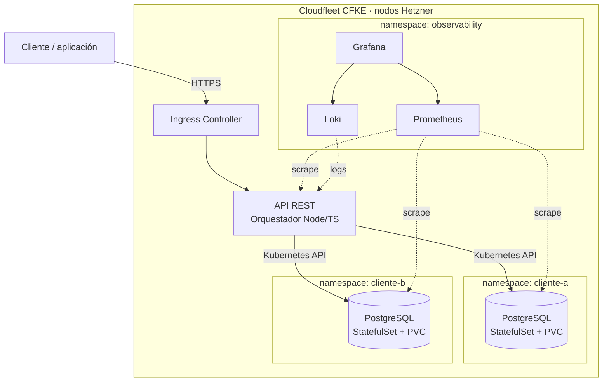

# DBaaS-Fleet

Plataforma de **Database as a Service** que aprovisiona instancias de **PostgreSQL** aisladas por cliente sobre Kubernetes, con infraestructura declarativa, CI/CD y observabilidad.

> Proyecto final de **ESI3905O · Infraestructura para el Desarrollo Continuo** — ITESO.
> Autor: **Angel Uriel Piña Aguilar** · Profesor: **Luis Eduardo Estrada Rodríguez**.

[](https://github.com/urielpinag/dbaas-fleet/actions/workflows/ci.yml)
[](LICENSE)
[](app/package.json)

---

## Estado

MVP en construcción. El único motor implementado es **PostgreSQL**; el resto del catálogo existe como roadmap y se expone en la API con `available: false`.

| Producto | Estado | Notas |
|---|---|---|
| PostgreSQL 16 | ✅ MVP | StatefulSet + PVC por cliente, namespace aislado |
| MongoDB | 🕓 Roadmap | Sin implementación; visible en el catálogo |
| S3 (Garage) | 🕓 Roadmap | Sin implementación; visible en el catálogo |
| WordPress + MariaDB | 🕓 Roadmap | Producto de hosting, fuera del alcance del curso |

## Problema y propuesta

Aprovisionar una base de datos suele implicar crear servidores, volúmenes, credenciales, respaldos y monitoreo a mano. DBaaS-Fleet convierte ese proceso en una llamada a la API: el orquestador crea un namespace, aplica cuotas y políticas de red, genera la contraseña, despliega el `StatefulSet` con su `PVC` y devuelve la cadena de conexión.

El proyecto es también el núcleo técnico de un negocio de DBaaS para agencias y freelancers en México (pago en pesos, CFDI, backups probados y migración asistida), documentado en [`docs/propuesta/`](docs/propuesta/).

## Arquitectura



Diagramas editables en [`docs/diagrams/`](docs/diagrams/).

## Stack

| Capa | Tecnología |
|---|---|
| API | Node.js 22, TypeScript, Express |
| Contenedores | Docker multi-stage, usuario sin privilegios |
| Orquestación | Kubernetes (Cloudfleet CFKE sobre Hetzner Cloud) |
| IaC | Terraform (`terraform.cloudfleet.ai/cloudfleet/cloudfleet`) |
| CI/CD | GitHub Actions |
| Registro de imágenes | GitHub Container Registry (GHCR) |
| Observabilidad | Prometheus, Grafana, Loki, postgres_exporter |
| Seguridad | Gitleaks, Trivy, CodeQL, RBAC, NetworkPolicy, ResourceQuota |
| Pruebas | Vitest, Supertest, kind (integración) |

## Estructura del repositorio

```text
.
├── app/                    # REST API (TypeScript)
│   ├── src/
│   │   ├── config.ts
│   │   ├── app.ts
│   │   └── index.ts
│   ├── tests/
│   ├── Dockerfile
│   └── package.json
├── terraform/              # Clúster CFKE + nodos Hetzner
├── k8s/                    # Manifiestos base y plantillas por cliente
├── observability/          # Values de kube-prometheus-stack y dashboards
├── docs/                   # Arquitectura, diagramas y propuesta
├── .github/                # CI/CD, plantillas de issues y PR
└── scripts/                # Utilidades de desarrollo y operación
```

## Desarrollo local

Requisitos: Node.js 22+, Docker y `kubectl`.

```bash
cd app
npm ci
npm run dev          # http://localhost:3000/health
npm test
npm run build
```

```bash
curl -s localhost:3000/health | jq
```

## Flujo de trabajo

- `main` está protegida: requiere Pull Request, checks de CI en verde y revisión.
- Ramas: `feature/*`, `fix/*`, `chore/*` y `docs/*`.
- Commits con [Conventional Commits](https://www.conventionalcommits.org/): `feat:`, `fix:`, `docs:`, `chore:`, `test:`, `ci:`.
- Cada PR cierra un issue (`Closes #N`) y pasa por Gitleaks y Trivy antes de mergear.

Ver [`CONTRIBUTING.md`](CONTRIBUTING.md).

## Roadmap

- [x] **M1 · Semanas 1-2** — Fundaciones: repo, tablero, protección de ramas, propuesta.
- [ ] **M2 · Semanas 3-5** — Infraestructura: Terraform, clúster CFKE, nodos Hetzner, state remoto.
- [ ] **M3 · Semanas 6-9** — API y DBaaS: capas, catálogo, orquestador, manifiestos, pruebas.
- [ ] **M4 · Semanas 10-12** — CI/CD y DevSecOps: Gitleaks, Trivy, CodeQL, GHCR, despliegue.
- [ ] **M5 · Semanas 13-16** — Observabilidad y entrega: métricas, logs, dashboards, Wiki, informe.

## Enlaces

- **Tablero Kanban:** <https://github.com/users/urielpinag/projects/1>
- **Wiki:** por publicar
- **Issues:** <https://github.com/urielpinag/dbaas-fleet/issues>
- **Actions:** <https://github.com/urielpinag/dbaas-fleet/actions>

## Uso de IA

El curso permite herramientas de IA en el proyecto final siempre que el equipo pueda explicar cada línea. En este repositorio la IA se usa para scaffolding, documentación y revisión; todo el código y la infraestructura son revisados, ejecutados y defendidos por el autor.

## Licencia

[MIT](LICENSE) © 2026 Angel Uriel Piña Aguilar
